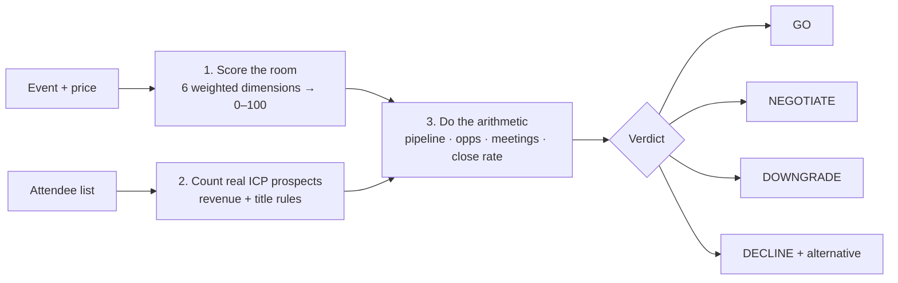

# Event Vetting: is this sponsorship worth it?

> **Outcome:** turns "this event feels right" into a number a CFO can check, like *"This $41,000 sponsorship needs 16 pre-booked meetings, and 1.4% of the qualified room has to become customers."*

A [Claude skill](https://docs.claude.com/en/docs/agents-and-tools/agent-skills/overview) I built for deciding whether a B2B event, conference sponsorship, trade show, field dinner or webinar is worth the money, and for proving it.

---

## The problem

Most event decisions are made on gut feel and defended afterwards. The usual reason a team can't show event ROI isn't the event itself. It's that **nobody wrote down what the event had to produce before buying it.**

## How it works

Three steps. Each one works alone, and they get stronger as more information comes in.



**1. Score the room.** Six dimensions, weighted and scored out of 100: ICP density, meeting mechanism, seniority, competitive and partner presence, list rights, and prior performance. The result maps to a tier (Flagship, Core, Test or Decline). Every score says which dimensions came from real data and which were inferred.

**2. Count the prospects.** Parses a messy attendee list (`£800m`, `1.2 billion`, blanks, `tbc`), sorts titles into economic buyer, champion and other, and shows the count under each definition. You can see how much the answer depends on the definition instead of having it hidden.

**3. Do the arithmetic.** Works from cost to required ARR, then pipeline, opportunities and a **meeting target**, and finally the **close rate the price implies**.

## Example run

Inputs (made up): $41,000 all-in · 50% margin · 18-month payback · 15% trailing win rate · $80,000 ACV.

```
$ python scripts/event_economics.py --cost 41000 --win-rate 0.15 --alt-win-rate 0.30 \
      --acv 80000 --icp-prospects 49

  REQUIRED PIPELINE                 $364,444   (8.9x spend)
  required opportunities            5
  MEETING TARGET                    16
  COST PER ICP PROSPECT             $837
  REQUIRED CLOSE RATE               1.39% of the qualified room must become customers

  At the alternative win rate of 30%:
    required pipeline               $182,222
    meeting target                  8
```

The same spend needs **twice the pipeline** at the real win rate compared with the aspirational one. Showing both side by side turns the win rate into a deliberate choice instead of a silent default. That's the most valuable thing this tool does.

See [`examples/`](examples/) for a full attendee-list analysis on a made-up 80-person list.

## Design choices I'm proud of

- **Get the inputs from finance before running the numbers.** Payback numbers built on invented inputs look confident and fall apart when finance checks them.
- **The meeting target is the headline,** because "book 16 meetings" is something a seller can act on, while "$364k of pipeline" is just a number people nod at.
- **Every decline comes with an alternative,** for example: "this budget buys seven executive dinners where every guest is a buyer."
- **Prior performance is scored honestly.** It stays at the neutral default until there's debrief data, rather than being given made-up variation.
- **Rounding:** per-event figures round up, but portfolio totals are calculated without rounding, so a 30-event calendar doesn't overstate its targets.

## What's in the repo

| Path | What it is |
|---|---|
| `SKILL.md` | The skill Claude loads: modes, workflow and how the verdict is reached |
| `references/scoring-rubric.md` | Six dimensions with full 1–5 scoring guides and special cases |
| `references/delegate-analysis.md` | ICP definitions, revenue parsing and common traps |
| `references/payback-model.md` | The maths, a worked example, sensitivity, and the four questions finance always asks |
| `assets/client-profile.md` | What to collect before scoring anything |
| `scripts/event_economics.py` | Works from cost to pipeline, meetings and close rate |
| `scripts/analyze_delegates.py` | Attendee-list parser and ICP counter |
| `examples/` | Made-up attendee list and output |

## Use it

Drop the folder into your Claude skills (Claude app → Settings → Capabilities → Skills, or `~/.claude/skills/`) and ask something like *"Is this $30k sponsorship worth it?"* The scripts also run on their own with Python 3 (`openpyxl` is needed for .xlsx files).

---

*Part of my [event ops toolkit](https://github.com/parker-lauren): [run the program](https://github.com/parker-lauren/event-program-os) → **vet the event** → [enrich the leads](https://github.com/parker-lauren/webinar-lead-enrichment) → [clean the list](https://github.com/parker-lauren/event-contact-list) → [debrief honestly](https://github.com/parker-lauren/event-debrief). All figures and data here are illustrative.*
